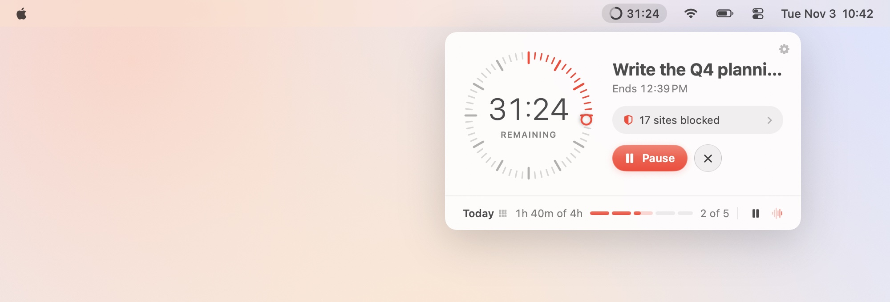
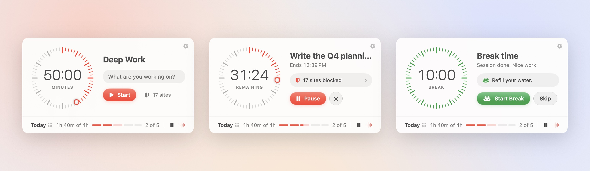
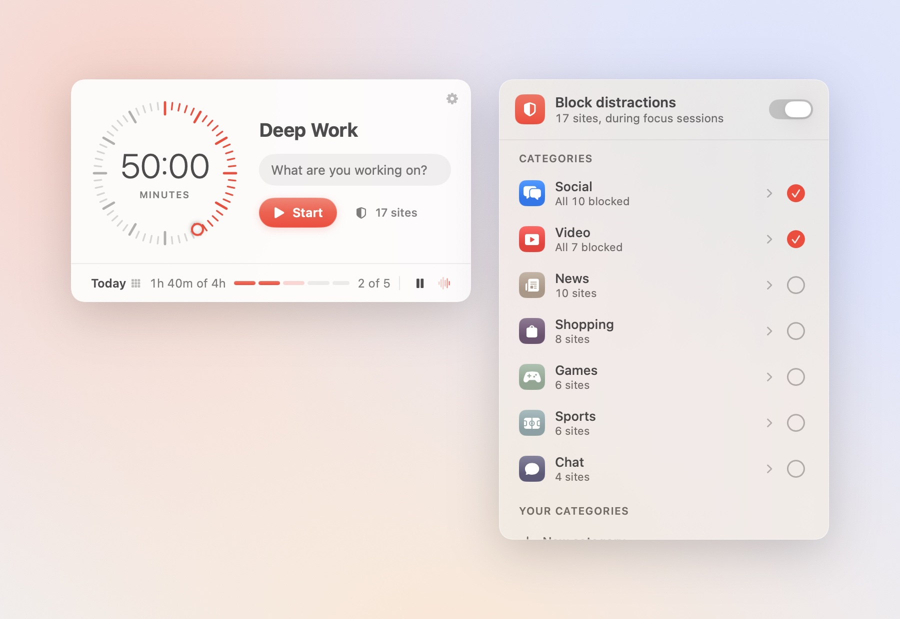
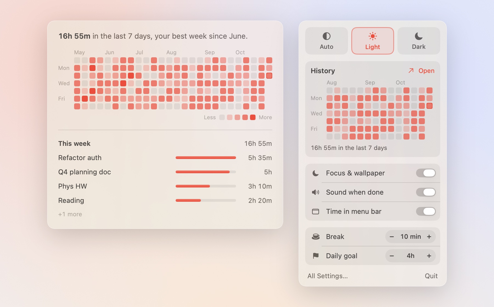
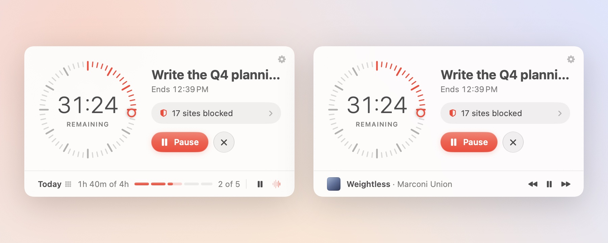

<h1 align="center">Deep End</h1>

<p align="center"><b>A deep work timer for your Mac's menu bar.</b><br>
Start a session and your Mac goes quiet: distracting sites are blocked, a Focus mode turns on,<br>
your music starts, and the timer counts down where you can see it. When it ends, everything goes back.</p>

<p align="center">
  <picture>
    <source media="(prefers-color-scheme: dark)" srcset="docs/screenshots/hero-dark.jpg">
    
  </picture>
</p>

<p align="center">
  <a href="#install">Install</a> ·
  <a href="#features">Features</a> ·
  <a href="#control-it-from-anywhere">URL commands</a> ·
  <a href="#how-it-works">How it works</a> ·
  <a href="#development">Development</a>
</p>

---

## Why

Most focus timers are a countdown and nothing else. Deep End handles the setup around the timer
so you don't have to: the sites you'd drift to, notifications, music, and remembering how much you
actually got done. It lives in the menu bar, takes one click to start, and stays out of the way.

## Features

### A timer that looks like a watch face

<p align="center">
  <picture>
    <source media="(prefers-color-scheme: dark)" srcset="docs/screenshots/states-dark.jpg">
    
  </picture>
</p>

- **Drag the dial** to set the length, or hover the time and **type your own** (`45`, `1:30`, `1h30`, `1.5h`).
- Say **what you're working on**. It's saved with the session and shows up in your history.
- The **menu bar shows a ring and the time left**, so you can glance at it without opening anything.
- **Work, then break**: 50 / 10 by default, with a 20-minute long break every few sessions.
  Breaks wait for you to start them instead of starting on their own.
- When a session ends, **the window opens by itself** with a sound, without taking your keyboard.
- **Light, dark or auto** appearance, with a light default that stays crisp over any wallpaper.

### Today, at a glance

The bar along the bottom is your day measured against your goal. Each segment is one session,
sized by how long it was or will be. Hover a segment to see its name and length; click the goal
("of 4h") to change it.

### Block distractions

<p align="center">
  <picture>
    <source media="(prefers-color-scheme: dark)" srcset="docs/screenshots/blocking-dark.jpg">
    
  </picture>
</p>

- Built-in categories (Social, Video, News, Shopping, Games, Sports, Chat). Open one to switch
  off individual sites.
- Make your own categories, or add one-off sites.
- Blocking is on only during focus sessions, never during breaks, and works in every browser.

### Focus mode, automatically

When a session starts, the Mac switches to the Focus mode you pick (Do Not Disturb by default), and
switches back when it ends. Deep End only turns off a Focus it turned on, never one you set
yourself. Optionally your wallpaper changes for the session too, and is always put back, even
after a crash. You can also have the **desktop icons hidden** for the session (Finder restarts
to hide and show them; its windows come back).

### History that tells you something

<p align="center">
  <picture>
    <source media="(prefers-color-scheme: dark)" srcset="docs/screenshots/history-dark.jpg">
    
  </picture>
</p>

- A **26-week grid**, each day shaded by how close you got to your goal.
- A **one-line summary** instead of a wall of numbers: your best week in a while, a streak worth
  keeping, or how this week compares to the last.
- **What you worked on** this week, by task. Hover any day to see its sessions.
- Click **Today** in the popover, or open it from the gear menu.

### Music, without leaving the timer

<p align="center">
  <picture>
    <source media="(prefers-color-scheme: dark)" srcset="docs/screenshots/music-dark.jpg">
    
  </picture>
</p>

- ⏯ sits at the end of the Today row. **Hover it** and the row turns into the current Spotify
  track with ⏮ ⏯ ⏭.
- Have a session **resume your music** or **start your focus playlist** (paste any Spotify
  playlist, album or song link), and pause it when the session ends.
- Not on Spotify? Choose **Any app** and the buttons control whatever's playing (Apple Music,
  a browser, podcasts) through macOS's media controls.

### Keyboard shortcuts

In the popover: <kbd>Return</kbd> start · <kbd>Space</kbd> pause or resume · <kbd>+</kbd> / <kbd>−</kbd> add or take off
5 minutes · <kbd>⌘</kbd><kbd>→</kbd> skip · <kbd>⌘</kbd><kbd>.</kbd> stop · <kbd>⌘</kbd><kbd>,</kbd> settings · <kbd>Esc</kbd> close.

## Install

Deep End is built from source. You need **macOS 26 (Tahoe) or later** and the **Xcode Command Line
Tools**; full Xcode isn't required.

```bash
xcode-select --install          # if you don't have the command line tools yet
git clone https://github.com/olyaiy/deep-end.git
cd deep-end
./build.sh
```

That builds **Deep End.app**, installs it to `~/Applications` and launches it. A timer icon appears
in the menu bar. Run `./build.sh` again after pulling changes; `./build.sh --no-install` only builds
into `./build`.

Updating never interrupts a session. The running app saves its timer, quits without undoing
blocking or Focus, and reopens as the new version, which carries on the countdown from where it
was. The menu bar icon blinks for a second; that's all. The same saved state means a crash
mid-session picks back up on the next launch too.

### One-time setup

Each of these is optional. Deep End works without them and tells you in Settings what's missing.

| Feature | What to do |
|---|---|
| **Site blocking** | Click the shield next to Start, then **Set Up…**. macOS asks for your password once. |
| **Focus mode** | Settings › During Focus › **Open Settings**, then add **Deep Work Focus** to Full Disk Access and click **Check Again**. |
| **Spotify** | The first time, macOS asks to let Deep End control Spotify. Click **Allow**. |
| **Open at login** | Settings › General › **Open at login**. |

## Control it from anywhere

Every action has a URL, so Shortcuts, Raycast, Alfred, a hotkey app or Terminal can drive it:

```bash
open "deepwork://start?minutes=50&intent=Write%20the%20doc"
open "deepwork://toggle"           # start, or pause/resume
open "deepwork://pause"            # also: resume, stop, skip
open "deepwork://add?minutes=10"   # also: subtract
open "deepwork://open"             # show the window
```

## How it works

<details>
<summary><b>Site blocking</b>: a marked section of <code>/etc/hosts</code></summary>

<br>

Blocked domains, plus their `www.`, `m.` and `mobile.` variants, are written into a marked section
of `/etc/hosts` when a session starts and removed when it ends, or the next time the app launches if
it was killed. Editing `/etc/hosts` needs root, so **Set Up…** installs two small files:

- `/usr/local/libexec/deepwork-block`: a root-owned script that only writes `0.0.0.0 <domain>`
  lines between its own markers. Input is checked to be domain names.
- `/etc/sudoers.d/deepworktimer`: lets your user run only that script without a password.

Tabs that are already open may keep working until reloaded, because browsers cache DNS for a
moment. To uninstall: `sudo rm /usr/local/libexec/deepwork-block /etc/sudoers.d/deepworktimer`.
</details>

<details>
<summary><b>Focus mode</b>: a small helper with Full Disk Access</summary>

<br>

macOS has no public API for turning a Focus on. Deep End ships a tiny helper app,
**Deep Work Focus.app**, that edits the Focus database (`~/Library/DoNotDisturb/DB/Assertions.json`)
and restarts the Focus service so the change takes effect. That folder is privacy-protected,
which is why the helper needs Full Disk Access. It's a separate app so the permission survives
rebuilds of the main app.

- The timer asks the helper for things through a request file, which a LaunchAgent watches.
- The helper keeps a backup of the original database in `~/Library/Application Support/DeepWorkTimer`.
- It remembers which Focus it created, so it never ends one you turned on yourself.

This uses macOS internals, so a future macOS update could break it. If that happens, blocking,
the timer and everything else keep working.
</details>

<details>
<summary><b>Wallpaper</b>: saved before, restored after</summary>

<br>

Each display's wallpaper is saved before it changes and restored afterwards: when you stop, quit,
`kill` the app, after a crash (on next launch), and for a display unplugged mid-session (when it
reconnects). Displays with a dynamic or aerial wallpaper are left alone, since those can't be put
back exactly.
</details>

<details>
<summary><b>Music</b>: AppleScript for Spotify, media keys for everything else</summary>

<br>

Spotify is controlled with AppleScript, which also gives the current track and artwork and can play
a link directly. With **Any app** chosen, or without Spotify installed, the buttons send the same
commands as your keyboard's media keys, through macOS's media controls. Those can't report what's
playing.
</details>

<details>
<summary><b>Privacy</b></summary>

<br>

Everything stays on your Mac: sessions, history and settings are stored in the app's preferences.
Nothing is sent anywhere. The app only talks to Spotify, and only on your Mac.
</details>

## Development

Swift and SwiftUI, built with Swift Package Manager. No Xcode project.

```bash
swift build -c release
.build/release/DeepWorkTimer --preview            # every state in one window, light and dark
.build/release/DeepWorkTimer --snapshot ./snaps   # render the screens to PNGs and exit
.build/release/DeepWorkTimer --showcase docs/screenshots   # retake the README screenshots
```

`--showcase` briefly opens each scene in a real window so it can capture glass and native
controls exactly. Expect windows to flash on screen for about 20 seconds. All three modes use
sample data and never touch your settings, Focus or wallpaper.

| File | What it does |
|---|---|
| `DeepWorkTimerApp.swift` | App entry point and `deepwork://` commands |
| `MenuBarController.swift` | The menu bar item and its window, which opens itself when a phase ends |
| `MenuContentView.swift` | The popover: dial, task, buttons and the Today row |
| `TimerRing.swift` | The watch-face dial and the menu bar ring |
| `SessionBar.swift` | Today's sessions laid out against your goal |
| `TimerModel.swift` | Phases, the countdown (based on an end date, so it survives sleep), daily stats |
| `SessionEffects.swift` | What happens when a session starts and ends: blocking, Focus, music, wallpaper |
| `SiteBlocker.swift`, `BlockPickerView.swift` | Site blocking and its picker |
| `FocusController.swift` | Talks to the Focus helper |
| `Sources/DeepWorkFocus/` | The Focus helper itself |
| `MusicController.swift`, `MusicFooter.swift` | Spotify and media controls, and their place in the Today row |
| `HistoryView.swift` | The history grid, summary line and per-task breakdown |
| `QuickSettingsView.swift`, `SettingsView.swift` | The gear menu and the Settings window |
| `Theme.swift`, `Prefs.swift` | Colours, buttons, settings keys and defaults |
| `Snapshot.swift`, `Showcase.swift` | Previews, snapshots and README screenshots |

## License

[MIT](LICENSE)
